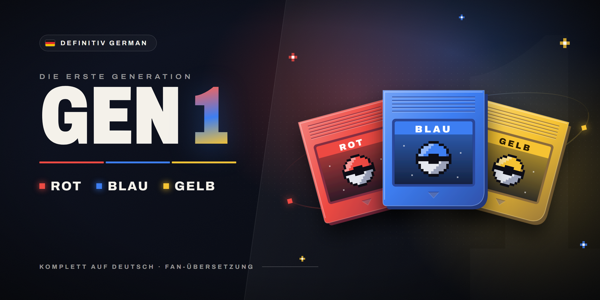

# Definitiv German Gen 1

Komplett deutsche Rote, Blaue und Gelbe Edition für [gen1recomp](https://github.com/bryanthaboi/gen1recomp) – so, als wäre
die englische ROM die deutsche.

*A full German translation mod for gen1recomp (Red, Blue, Yellow). It reads everything from your own German ROMs.*

## Was der Mod macht

- **Alle Texte** – Dialoge, Kämpfe, Menüs, Pokédex-Einträge, Abspann – im Wortlaut der deutschen Originale
- **Alle Namen** – Pokémon, Attacken, Items, Trainer, Typen, Orte
- **Deutsche Schrift** – Umlaute, ß und die Sonderzeichen der deutschen Spiele
- **Deutsche Grafiken** – Titelbild (ROTE / BLAUE / GELBE EDITION), Copyright-Zeile, Spielautomat, Pokédex-Einheiten, Gelb: Surf-Minigame, Druckerdiplom und Drucker
- **Deutsche Anordnung** – Menüs und Kästen sitzen wie im deutschen Original
- **Zusätze von gen1recomp** – Mod-Verwaltung, Optionen und Link-Meldungen auf Deutsch; der Launcher bleibt
  englisch

## Bekannte Grenze: Online-Spiel

Die Online-Funktionen von gen1recomp (KONNEX-Klub online, Arenen und Turniere) sind mit aktivem Mod **nicht
nutzbar**. gen1recomp lässt online nur reine Übersetzungs-Mods zu, die nichts am Programm ändern. Dieser Mod muss
aber ins Programm eingreifen, um alles aus deiner deutschen ROM zu lesen. Außerdem darf online grundsätzlich kein
Mod die Namen von Pokémon, Attacken und Items ändern.

Zum Online-Spielen den Mod im Launcher unter **MODS** abschalten – online ist das Spiel dann englisch. Das ist eine
Vorgabe von gen1recomp und lässt sich nicht im Mod lösen, ohne diese Prüfung zu umgehen.

## Keine ROM-Inhalte enthalten

Der Mod enthält **keine Texte oder Grafiken der Spiele**. Er bringt nur Code und „Rezepte“ mit (Positionen in der
ROM). Beim Start liest er deine eigene deutsche ROM und baut daraus alles zusammen.

## Voraussetzungen

- gen1recomp (getestet mit **0.3.95**), mit importierter englischer ROM wie gewohnt
- Deine **deutsche ROM** der Edition, die du spielen willst (jede Edition braucht nur ihre eigene):

| Edition | MD5 |
|---|---|
| Rote Edition | `8ed0e8d45a81ca34de625d930148a512` |
| Blaue Edition | `a1ec7f07c7b4251d5fafc50622d546f8` |
| Gelbe Edition | `e93f10168e3c9b9d18e3ad4a1415e1d0` |

## Installation

1. Im Launcher unter **MODS** den Mod suchen und installieren – oder die `.zip` aus dem
   [neuesten Release](https://github.com/FadeyMods/Definitiv-German-Gen-1/releases/latest) über
   **Import mod .zip** einspielen.
2. In den **Details** des Mods die deutsche(n) ROM(s) auswählen. Der Launcher prüft sie und legt sie beim Mod ab.
3. Mod aktivieren und spielen.

Falls noch der ältere Mod `deutsch-gen1` installiert ist: bitte entfernen – der Launcher meldet sonst einen
Konflikt.

Was sich in einer Version geändert hat, steht im jeweiligen
[Release](https://github.com/FadeyMods/Definitiv-German-Gen-1/releases).

Weitere Generationen: [Definitiv German Gen 2](https://github.com/FadeyMods/Definitiv-German-Gen-2) · [Definitiv German Gen 3](https://github.com/FadeyMods/Definitiv-German-Gen-3)
